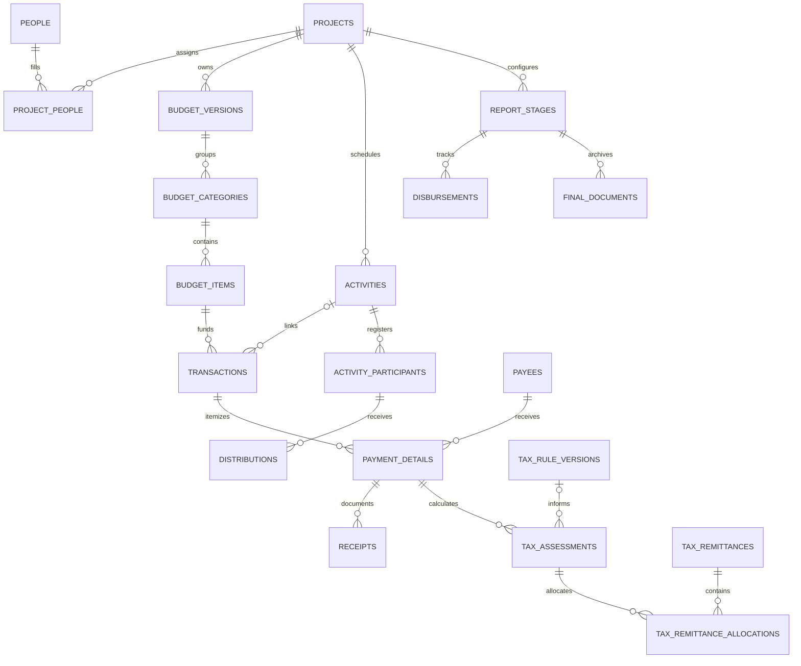

# Arsitektur dan ERD LPJ Litapdimas

Status: kontrak desain awal untuk [PRD.md](PRD.md).

## Runtime dan struktur folder

Antarmuka React + Vite dihosting di GitHub Pages (`github.io`). Google Sheets privat menyimpan tabel dan Google Drive privat menyimpan berkas bukti serta PDF. GitHub menyimpan sumber dan fixture sintetis. Google Apps Script menjadi kandidat layanan Tahap 0 tanpa mengaktifkan billing. Karena GitHub Pages menyajikan situs statis, adapter RPC di browser perlu memanggil layanan server yang memverifikasi identitas Google, mengecek peran dan cakupan proyek pada setiap permintaan, lalu mengakses Sheets dan Drive dengan izin layanan. Tahap 0 masih perlu menguji transport dan konfigurasi autentikasi Apps Script dari origin GitHub Pages. [Dokumentasi GitHub Pages](https://docs.github.com/en/pages/getting-started-with-github-pages/what-is-github-pages).

```text
src/
  app/               # navigasi dan shell
  features/          # projects, people, budgets, activities, transactions, taxes, reports
  components/ui/     # komponen bersama dan CSS Modules
  styles/            # tokens.css, globals.css, print.css
  lib/api/           # adapter RPC dan penanganan kegagalan
server/
  controllers/       # autentikasi, otorisasi, validasi envelope
  services/          # aturan domain dan alur dokumen
  repositories/      # akses tabel Sheets dan berkas Drive
  templates/         # template dokumen berversi
shared/contracts/    # DTO, action dan enum
tests/fixtures/      # data sintetis
```

UI menampilkan respons layanan. Perhitungan, perpindahan status, akses proyek, pemilihan aturan pajak dan snapshot berlaku di server. Repositori memakai header tabel dan ID stabil untuk lookup.

[Prototipe Tahap 0](stage0/README.md) memakai Google Sign-In di GitHub Pages dan POST Apps Script Content Service. Apps Script memvalidasi ID token melalui `tokeninfo` untuk uji sintetis, lalu menerapkan pemeriksaan keanggotaan yang sama dengan prototipe HTML Service. Sembilan pengujian lokal lulus dengan layanan Google disimulasikan. Pengguna melaporkan login dan akses dasar ketiga akun sesuai peran dari `github.io`. Uji penolakan di luar cakupan, perubahan hak pada sesi aktif, dan izin langsung Sheets/Drive masih tertunda. Verifikasi token produksi menunggu keputusan setelah uji. [Verifikasi token Google](https://developers.google.com/identity/gsi/web/guides/verify-google-id-token).

## Konvensi

Nama sheet, kolom, dan DTO memakai `snake_case`. ID entitas adalah UUID teks. Mata uang adalah integer rupiah. Persentase tersimpan dalam basis point (`7000 = 70%`). Tanggal kegiatan/pembayaran berupa `YYYY-MM-DD` dalam zona Asia/Jakarta. Stempel audit berupa ISO 8601 UTC. Setiap tabel mutabel memiliki `row_version`, `created_at`, dan `updated_at`. Kolom FK mengikuti nama PK tabel tujuan, kecuali qualifier seperti `approved_by_user_id`. Impor memperlakukan NIP/NIM sebagai teks. Validasi daftar nilai, tipe, FK dan kepemilikan proyek dilakukan pada setiap operasi.

## Skema Sheets

Setiap baris di bawah adalah satu tab logis. Kolom pertama adalah PK kecuali dinyatakan lain.

| Sheet | Kolom domain utama |
| --- | --- |
| users | user_id, login_email, system_role, active |
| project_members | project_member_id, project_id, user_id, project_role, revoked_at opsional. Unik project_id + user_id |
| people | person_id, person_kind, display_name, nip, nim, unit_name, civil_service_grade, active |
| payees | payee_id, payee_kind, person_id opsional, legal_name, tax_profile_ref. Vendor badan dan kelompok peserta dapat memakai entri sendiri |
| projects | project_id, fiscal_year, title, project_code, official_ceiling_amount, status, active_budget_version_id |
| project_people | project_person_id, project_id, person_id, assignment_role. Peran tunggal ketua, penanggung jawab, PPK, bendahara. Anggota, mahasiswa dan pejabat tambahan multi-entri |
| budget_versions | budget_version_id, project_id, version_no, status, approved_by_user_id, approved_at |
| budget_categories | budget_category_id, budget_version_id, category_code, label, sort_order |
| budget_items | budget_item_id, budget_category_id, label, volume, frequency, unit, unit_price_amount |
| report_stages | report_stage_id, project_id, sequence_no, label, target_bps, cutoff_date, status |
| disbursements | disbursement_id, report_stage_id, received_date, received_amount, attachment_id opsional |
| activities | activity_id, project_id, activity_kind, title, activity_date, location, status |
| agenda_items | agenda_item_id, activity_id, start_time, end_time, title, speaker_person_id opsional |
| logbook_entries | logbook_entry_id, project_id, activity_id opsional, entry_date, description, result |
| activity_participants | activity_participant_id, activity_id, person_id, attendance_status. Unik activity_id + person_id |
| distributions | distribution_id, activity_participant_id, transaction_id opsional, distribution_kind, quantity, received_at |
| transactions | transaction_id, project_id, budget_item_id, activity_id opsional, payment_date, expense_kind, description, status |
| payment_details | payment_detail_id, transaction_id, payee_id, receipt_amount, withheld_tax_amount, added_tax_amount, net_paid_amount |
| receipts | receipt_id, payment_detail_id, project_id, receipt_no, issued_on, status. Unik project_id + receipt_no dan satu bukti aktif per payment_detail_id |
| tax_rule_versions | tax_rule_version_id, rule_code, version_no, tax_kind, expense_kind, payee_kind, eligibility, base_kind, rate_bps, effective_from, effective_to, source_ref |
| tax_assessments | tax_assessment_id, payment_detail_id, tax_rule_version_id opsional, tax_kind, tax_treatment, tax_base_amount, amount, status, verified_by_user_id, verified_at, override_reason |
| tax_remittances | tax_remittance_id, project_id, paid_at, amount, attachment_id opsional |
| tax_remittance_allocations | tax_remittance_allocation_id, tax_remittance_id, tax_assessment_id, amount |
| attachments | attachment_id, project_id, activity_id opsional, transaction_id opsional, attachment_kind, drive_file_id |
| final_documents | final_document_id, project_id, report_stage_id, document_kind, version_no, template_version, pdf_drive_file_id, snapshot_drive_file_id, finalized_by_user_id, finalized_at |
| audit_log | audit_id, request_id, user_id, project_id opsional, action, entity_type, entity_id, occurred_at, change_summary |
| mutation_requests | request_id, user_id, action, payload_digest, result_ref, status |
| settings | setting_key, setting_value. Simpan versi skema dan konfigurasi non-rahasia |



## Kontrak RPC v1

Satu adapter UI mengirim objek ke controller `dispatch`. Controller menerima action yang terdaftar, menurunkan identitas dari sesi tepercaya, lalu mengecek peran dan cakupan proyek. Semua mutasi memakai `request_id`. Mutasi atas baris yang sudah ada menyertakan `expected_row_version` atau versi pada tiap baris untuk batch. Parameter tanggal dan waktu dikirim sebagai string.

```json
{"api_version":1,"action":"transactions.confirm","request_id":"<uuid>","project_id":"<uuid>","payload":{"transaction_id":"<uuid>","expected_row_version":4}}
```

```json
{"ok":true,"request_id":"<uuid>","data":{"transaction_id":"<uuid>","row_version":5,"status":"CONFIRMED"}}
```

```json
{"ok":false,"request_id":"<uuid>","error":{"code":"TAX_REVIEW_REQUIRED","message":"Pajak transaksi perlu diverifikasi.","field_errors":{}}}
```

| Action | Masukan utama | Keluaran dan akses |
| --- | --- | --- |
| projects.list / projects.get | cursor, limit / project_id | Proyek dalam cakupan pengguna |
| projects.save / projects.activate | data wizard / project_id dan versi | Pemilik. Aktivasi memeriksa kelengkapan peran |
| people.search / people.preview_import / people.commit_import | query / baris dari CSV atau XLSX / import_token | Pencarian sesuai akses. Impor oleh pemilik menghasilkan ringkasan dan konflik |
| budgets.list_versions / budgets.save_version / budgets.approve_version | budget_version_id opsional / kategori dan item / budget_version_id dan versi baris | Pembaca berwenang melihat riwayat. Pemilik dan editor menyusun draf. Pemilik mengesahkan versi |
| activities.save / participants.preview_import / participants.commit_import / distributions.save / logbook.save | data kegiatan, agenda, peserta, distribusi, logbook | Pemilik atau anggota dengan hak edit pada proyek |
| logbook.list | project_id | Entri dan pilihan kegiatan dalam proyek pengguna, beserta can_write berdasarkan peran dan status proyek |
| disbursements.save | report_stage_id, received_date, received_amount, attachment_id | Pemilik |
| transactions.list / transactions.save | filter / rincian transaksi, pembayaran, penerima, bukti | Pembaca berwenang / anggota dengan hak edit pada proyek |
| taxes.save_rule_version / taxes.preview / taxes.verify | aturan / payment_detail_id / assessment, hasil dan alasan koreksi jika ada | Kelola dan verifikasi oleh pemilik. Preview tersedia bagi anggota dengan hak edit |
| tax_remittances.save | paid_at, amount, allocation dan bukti | Pemilik. Alokasi tidak melebihi potongan terkait |
| transactions.confirm / receipts.issue | transaction_id / payment_detail_id | Pemilik. Konfirmasi dan penerbitan mengembalikan versi atau nomor bukti |
| stages.save / reports.preview / reports.finalize | konfigurasi / report_stage_id, document_kind / pilihan paket dan versi sumber | Pemilik menetapkan tahap dan finalisasi. Pratinjau tersedia bagi anggota yang punya akses |
| attachments.link / attachments.get | konteks dan file Drive yang sudah diotorisasi / attachment_id | Hak akses mengikuti proyek dan berkas |
| audit.list | project_id, cursor, limit | Pemilik |

Untuk tahap awal, `projects.list` juga mengembalikan `system_role` dari akun yang sudah diverifikasi untuk menentukan menu di UI. Pencarian Master Personel tanpa konteks proyek hanya untuk pemilik. `people.search` menerima `payload.query` (maksimal 120 karakter) dan mengembalikan maksimal 50 entri aktif yang cocok berdasarkan nama atau unit, serta `total` kecocokan. Hasil memuat `person_id`, `person_kind`, `display_name`, dan `unit_name`. Fixture lama tanpa kolom `active` tetap dapat dibaca selama pengembangan.

Wizard pembuatan mengirim `projects.save` tanpa `project_id`. Payload berisi `project` (judul, kode opsional, tahun anggaran, plafon), `personnel` (ID personel dan peran), dan `stages` (urutan, label, basis point, tanggal batas). Proyek lengkap disimpan sebagai `DRAFT`. `projects.activate` menerima `project_id` dan `payload.expected_row_version`, lalu memvalidasi ulang isi draf dan referensi personel sebelum memindahkan status menjadi `ACTIVE`. Kedua aksi mengembalikan `project_id`, `status`, dan `row_version`. `projects.list` menyertakan `can_create_project` saat akun pemilik dan deployment mengaktifkan penulisan. Penyuntingan draf yang sudah tersimpan belum tersedia pada irisan ini.

Impor Master Personel memetakan CSV atau lembar pertama XLSX di browser. `people.preview_import` menerima `payload.rows`, yaitu baris berisi `source_row` dan field master yang dipetakan. Server mengembalikan `import_token`, klasifikasi per baris, dan jumlah untuk tiap status. `people.commit_import` menerima baris yang sama serta token. Token berumur hingga 10 menit dan terikat pada pemilik, spreadsheet, isi batch, dan hasil pratinjau. Commit memeriksa ulang konflik di bawah lock, menambahkan baris valid, dan menyimpan audit serta jurnal permintaan dalam satu batch. Duplikasi diperiksa berdasarkan `person_id`, NIP, atau NIM. Menu impor muncul ketika `projects.list` mengembalikan `can_import_people`.

RAB memakai `project_id` pada setiap RPC. `budgets.list_versions` dapat memilih `payload.budget_version_id` dan mengembalikan versi proyek, riwayat, rincian versi terpilih, plafon, total, dan selisih. `budgets.save_version` membuat draf baru dari `payload.categories` beserta item. Versi yang sudah tersimpan memiliki item dengan ID stabil. `budgets.approve_version` memeriksa `payload.expected_row_version` dan `payload.expected_project_row_version`. Pengesahan mengubah proyek dan kedua status versi dalam satu batch. Versi lama berstatus `SUPERSEDED` dan tetap dapat dibuka. Volume dapat memiliki hingga tiga desimal, frekuensi bilangan bulat positif, dan harga satuan rupiah integer. Server menghitung dalam seperseribu rupiah sebelum membulatkan tiap baris ke rupiah terdekat, dengan setengah rupiah dibulatkan ke atas. Nominal berskala per baris dan total rupiah harus berada dalam batas integer aman JavaScript. Selisih adalah plafon dikurangi jumlah seluruh baris.

Gunakan `UNAUTHENTICATED`, `FORBIDDEN`, `NOT_FOUND`, `VALIDATION_ERROR`, `CONFLICT`, `TAX_REVIEW_REQUIRED`, dan `TEMPORARY_FAILURE` untuk kegagalan yang dapat ditangani klien. Pratinjau impor menghasilkan token berumur terbatas, terikat pengguna dan isi batch. Commit memeriksa ulang duplikasi dan hak akses.

Irisan awal LPJ-04 menyediakan `activities.list`, `activities.get`, dan `activities.save` pada proyek yang diotorisasi. List mengembalikan `activities`; get menerima `payload.activity_id` dan mengembalikan `activity` beserta `agenda`. Save hanya membuat draf baru dari `payload.activity` (`activity_kind`, `title`, `activity_date`, `location`) dan `payload.agenda` (daftar `start_time`, `end_time`, `title`, `speaker_person_id` opsional). Jam memakai `HH:mm`, sesi dalam satu hari harus berurutan tanpa tumpang tindih. Pembicara merujuk Master Personel aktif. Server menghasilkan ID dan status, lalu menyimpan kegiatan, sesi, audit, serta jurnal idempotensi dalam satu batch di bawah script lock. Pemilik/editor dapat membuat pada proyek `DRAFT` atau `ACTIVE`; viewer hanya membaca. Retry yang sudah selesai dapat dibaca kembali setelah proyek diarsipkan selama akses pengguna masih berlaku. Aktifkan `ACTIVITIES_ENABLED` hanya di deployment sintetis yang skemanya siap. Penyuntingan kegiatan, peserta, dan distribusi menyusul; LPJ-04 belum lengkap.

`logbook.save` menerima `payload.entry_date`, `description`, `result`, dan `activity_id` opsional (kosong berarti tanpa kegiatan). Uraian serta hasil wajib terisi dan masing-masing dibatasi 4.000 karakter. Untuk menyunting, kirim `logbook_entry_id` dan `expected_row_version`; server menolak versi lama dengan `CONFLICT`. ID entri serta kegiatan harus berasal dari proyek pada envelope. Respons save memuat `logbook_entry_id` dan `row_version`. `logbook.list` mengembalikan `entries` (dengan `activity_title` untuk tampilan), `activities` (ID/judul/tanggal kegiatan proyek), dan `can_write`. Entri diurutkan dari tanggal terbaru. List tersedia bagi pembaca proyek; penulisan hanya untuk pemilik/editor pada proyek draf atau aktif. Semua penulisan memakai lock, pemeriksaan jurnal idempotensi, serta batch atomik entri/audit/jurnal. Koreksi mempertahankan `created_at` dan menyimpan sebelum/sesudah dalam audit. `LOGBOOK_ENABLED` mengaktifkan fitur pada deployment sintetis dan menentukan `logbook_enabled` di respons `projects.get`. UI logbook menyediakan tambah/sunting, kegiatan opsional, pencarian, delapan entri per halaman, serta retry dengan isian dan UUID yang sama jika hasil simpan belum diketahui.

## Integritas dan operasi

UI kegiatan berada di `src/features/activities/ActivityWorkspace.jsx`, ditampilkan dari detail proyek saat `projects.get` mengembalikan `activities_enabled=true`. Respons personel proyek menyertakan `person_id` untuk pilihan pembicara. `activities.list` menyertakan `can_write` berdasarkan peran dan status proyek yang diperiksa server. `activities.get` menyertakan `speaker_display_name` pada sesi untuk tampilan, tanpa mengubah referensi `speaker_person_id`. UI membatasi tampilan daftar menjadi delapan kegiatan per halaman. Jika koneksi gagal setelah kirim simpan, UI mengunci isian dan memakai payload serta UUID yang sama saat retry; kesalahan domain yang definitif membolehkan koreksi isian. Irisan UI ini belum menyediakan penyuntingan kegiatan yang tersimpan. Pengujian browser memakai RPC dan login sintetis, bukan bukti integrasi Google sungguhan.

- Peran sistem `OWNER` dan `MEMBER`. Pemilik mengelola semua proyek. Anggota yang diundang memiliki `EDITOR` atau `VIEWER` pada `project_members` untuk tiap proyek yang ditugaskan. Tambahkan `revoked_at` untuk pencabutan. Server mengecek akun aktif, proyek, dan hak pada setiap RPC serta akses lampiran. PPK, Bendahara Pengeluaran, dan mahasiswa tercatat di `project_people` untuk dokumen LPJ tanpa akun atau hak aplikasi. Akun tanpa identitas tepercaya ditolak.
- Status inti: proyek `DRAFT / ACTIVE / ARCHIVED`, RAB `DRAFT / APPROVED / SUPERSEDED`, transaksi `DRAFT / CONFIRMED / VOID`, pajak `PENDING / VERIFIED / NOT_APPLICABLE`, kwitansi `ISSUED / VOID`, tahap `DRAFT / FINALIZED`. `NOT_APPLICABLE` dicatat oleh pemilik. Koreksi dokumen final diterbitkan sebagai versi baru dengan jejak audit.
- Hitung target dari plafon dan `target_bps`. Realisasi kumulatif menjumlahkan `receipt_amount` untuk rincian transaksi `CONFIRMED` sampai tanggal batas yang inklusif. `receipt_amount` adalah nilai yang disahkan sebagai dasar LPJ dari kwitansi. `net_paid_amount` adalah pembayaran ke penerima. Untuk honor, netto sama dengan nilai bruto dikurangi potongan. Untuk vendor, rekonsiliasi bagian pajak tambahan terhadap bukti tagihan agar bagian yang sudah termasuk dalam nominal kwitansi tidak ditambahkan kembali. Nilai dan status final tunduk pada verifikasi pemilik berdasarkan bukti. Setoran memiliki rekap tersendiri.
- Pemilihan versi aturan pajak memakai tanggal transaksi dan profil penerima yang relevan. Ketiadaan aturan, data yang kurang, atau dua aturan yang sama-sama cocok menghasilkan `PENDING`. Data historis 4% konsumsi dan snack tidak menjadi tarif default.
- Layanan penulisan memakai script lock untuk pemeriksaan versi dan alokasi nomor bukti, serta jurnal permintaan untuk idempotensi. Tulis perubahan Sheet terkait, audit, dan hasil permintaan dalam satu batch atomik pada spreadsheet yang sama. Pemakaian ulang request ID dengan payload berbeda menghasilkan konflik. Penerbitan PDF ke Drive memakai ID operasi dan publikasi metadata final sesudah file dan snapshot tersedia. Operasi parsial dapat dilanjutkan dengan ID yang sama.
- Isolasi spreadsheet, folder Drive dan konfigurasi produksi. Gunakan akses minimum, cadangan sheet dan file secara berkala, serta uji pemulihan dengan akun pemilik. Pastikan izin langsung ke file privat tidak dapat dipakai untuk melewati otorisasi layanan. Uji penolakan identitas kosong, akun tanpa undangan, dan akses lintas proyek sebelum deployment produksi.
