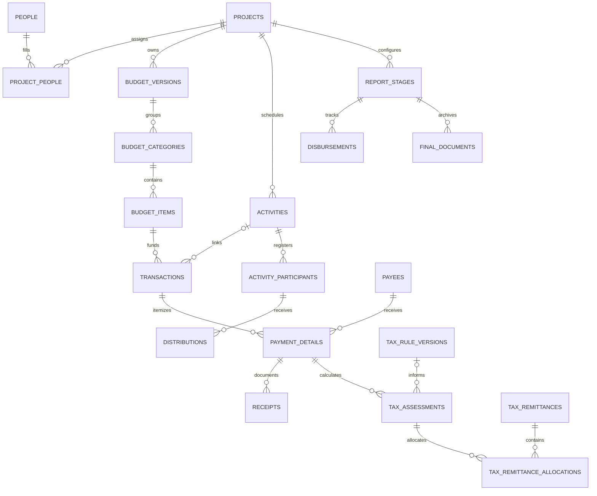

# Arsitektur dan ERD LPJ Litapdimas

Status: kontrak desain awal untuk [PRD.md](PRD.md).

## Runtime dan struktur folder

React + Vite untuk UI, Google Apps Script untuk layanan aplikasi, Google Sheets sebagai penyimpanan tabel, Google Drive untuk berkas bukti dan PDF. GitHub menyimpan sumber dan fixture sintetis. Rencana awal memakai GitHub Pages. Sebelum membangun transport produksi, uji identitas server dan kontrol akses dengan akun kampus. Opsi yang diusulkan untuk spike adalah membundel UI Vite ke Apps Script HTML Service dan memakai [google.script.run](https://developers.google.com/apps-script/guides/html/communication). Gunakan opsi ini hanya bila identitas pengguna dan hak akses data dapat ditegakkan. GitHub Pages dapat menyajikan preview sintetis. Pemilihan hosting produksi menunggu hasil spike.

```text
src/
  app/               # navigasi dan shell
  features/          # projects, people, budgets, activities, transactions, taxes, reports
  components/ui/     # komponen bersama dan CSS Modules
  styles/            # tokens.css, globals.css, print.css
  lib/api/           # adapter RPC dan penanganan kegagalan
server/
  controllers/       # autentikasi, otorisasi, validasi envelope
  services/          # aturan domain dan alur dokumen
  repositories/      # akses tabel Sheets dan berkas Drive
  templates/         # template dokumen berversi
shared/contracts/    # DTO, action dan enum
tests/fixtures/      # data sintetis
```

UI menampilkan respons layanan. Perhitungan, perpindahan status, akses proyek, pemilihan aturan pajak dan snapshot berlaku di server. Repositori memakai header tabel dan ID stabil untuk lookup.

## Konvensi

Nama sheet, kolom, dan DTO memakai `snake_case`. ID entitas adalah UUID teks. Mata uang adalah integer rupiah. Persentase tersimpan dalam basis point (`7000 = 70%`). Tanggal kegiatan/pembayaran berupa `YYYY-MM-DD` dalam zona Asia/Jakarta. Stempel audit berupa ISO 8601 UTC. Setiap tabel mutabel memiliki `row_version`, `created_at`, dan `updated_at`. Kolom FK mengikuti nama PK tabel tujuan, kecuali qualifier seperti `approved_by_user_id`. Impor memperlakukan NIP/NIM sebagai teks. Validasi daftar nilai, tipe, FK dan kepemilikan proyek dilakukan pada setiap operasi.

## Skema Sheets

Setiap baris di bawah adalah satu tab logis. Kolom pertama adalah PK kecuali dinyatakan lain.

| Sheet | Kolom domain utama |
| --- | --- |
| users | user_id, login_email, system_role, active |
| project_members | project_member_id, project_id, user_id, project_role, revoked_at opsional. Unik project_id + user_id |
| people | person_id, person_kind, display_name, nip, nim, unit_name, civil_service_grade, active |
| payees | payee_id, payee_kind, person_id opsional, legal_name, tax_profile_ref. Vendor badan dan kelompok peserta dapat memakai entri sendiri |
| projects | project_id, fiscal_year, title, project_code, official_ceiling_amount, status, active_budget_version_id |
| project_people | project_person_id, project_id, person_id, assignment_role. Peran tunggal ketua, penanggung jawab, PPK, bendahara. Anggota, mahasiswa dan pejabat tambahan multi-entri |
| budget_versions | budget_version_id, project_id, version_no, status, approved_by_user_id, approved_at |
| budget_categories | budget_category_id, budget_version_id, category_code, label, sort_order |
| budget_items | budget_item_id, budget_category_id, label, volume, frequency, unit, unit_price_amount |
| report_stages | report_stage_id, project_id, sequence_no, label, target_bps, cutoff_date, status |
| disbursements | disbursement_id, report_stage_id, received_date, received_amount, attachment_id opsional |
| activities | activity_id, project_id, activity_kind, title, activity_date, location, status |
| agenda_items | agenda_item_id, activity_id, start_time, end_time, title, speaker_person_id opsional |
| logbook_entries | logbook_entry_id, project_id, activity_id opsional, entry_date, description, result |
| activity_participants | activity_participant_id, activity_id, person_id, attendance_status. Unik activity_id + person_id |
| distributions | distribution_id, activity_participant_id, transaction_id opsional, distribution_kind, quantity, received_at |
| transactions | transaction_id, project_id, budget_item_id, activity_id opsional, payment_date, expense_kind, description, status |
| payment_details | payment_detail_id, transaction_id, payee_id, receipt_amount, withheld_tax_amount, added_tax_amount, net_paid_amount |
| receipts | receipt_id, payment_detail_id, project_id, receipt_no, issued_on, status. Unik project_id + receipt_no dan satu bukti aktif per payment_detail_id |
| tax_rule_versions | tax_rule_version_id, rule_code, version_no, tax_kind, expense_kind, payee_kind, eligibility, base_kind, rate_bps, effective_from, effective_to, source_ref |
| tax_assessments | tax_assessment_id, payment_detail_id, tax_rule_version_id opsional, tax_kind, tax_treatment, tax_base_amount, amount, status, verified_by_user_id, verified_at, override_reason |
| tax_remittances | tax_remittance_id, project_id, paid_at, amount, attachment_id opsional |
| tax_remittance_allocations | tax_remittance_allocation_id, tax_remittance_id, tax_assessment_id, amount |
| attachments | attachment_id, project_id, activity_id opsional, transaction_id opsional, attachment_kind, drive_file_id |
| final_documents | final_document_id, project_id, report_stage_id, document_kind, version_no, template_version, pdf_drive_file_id, snapshot_drive_file_id, finalized_by_user_id, finalized_at |
| audit_log | audit_id, request_id, user_id, project_id opsional, action, entity_type, entity_id, occurred_at, change_summary |
| mutation_requests | request_id, user_id, action, payload_digest, result_ref, status |
| settings | setting_key, setting_value. Simpan versi skema dan konfigurasi non-rahasia |



## Kontrak RPC v1

Satu adapter UI mengirim objek ke controller `dispatch`. Controller menerima action yang terdaftar, menurunkan identitas dari sesi tepercaya, lalu mengecek peran dan cakupan proyek. Semua mutasi memakai `request_id`. Mutasi atas baris yang sudah ada menyertakan `expected_row_version` atau versi pada tiap baris untuk batch. Parameter tanggal dan waktu dikirim sebagai string.

```json
{"api_version":1,"action":"transactions.confirm","request_id":"<uuid>","project_id":"<uuid>","payload":{"transaction_id":"<uuid>","expected_row_version":4}}
```

```json
{"ok":true,"request_id":"<uuid>","data":{"transaction_id":"<uuid>","row_version":5,"status":"CONFIRMED"}}
```

```json
{"ok":false,"request_id":"<uuid>","error":{"code":"TAX_REVIEW_REQUIRED","message":"Pajak transaksi perlu diverifikasi.","field_errors":{}}}
```

| Action | Masukan utama | Keluaran dan akses |
| --- | --- | --- |
| projects.list / projects.get | cursor, limit / project_id | Proyek dalam cakupan pengguna |
| projects.save / projects.activate | data wizard / project_id dan versi | Pemilik. Aktivasi memeriksa kelengkapan peran |
| people.search / people.preview_import / people.commit_import | query / baris dari CSV atau XLSX / import_token | Pencarian sesuai akses. Impor oleh pemilik menghasilkan ringkasan dan konflik |
| budgets.save_version / budgets.approve_version | kategori dan item / budget_version_id | Anggota dengan hak edit menyusun draf. Pemilik mencatat versi yang disetujui |
| activities.save / participants.preview_import / participants.commit_import / distributions.save / logbook.save | data kegiatan, agenda, peserta, distribusi, logbook | Pemilik atau anggota dengan hak edit pada proyek |
| disbursements.save | report_stage_id, received_date, received_amount, attachment_id | Pemilik |
| transactions.list / transactions.save | filter / rincian transaksi, pembayaran, penerima, bukti | Pembaca berwenang / anggota dengan hak edit pada proyek |
| taxes.save_rule_version / taxes.preview / taxes.verify | aturan / payment_detail_id / assessment, hasil dan alasan koreksi jika ada | Kelola dan verifikasi oleh pemilik. Preview tersedia bagi anggota dengan hak edit |
| tax_remittances.save | paid_at, amount, allocation dan bukti | Pemilik. Alokasi tidak melebihi potongan terkait |
| transactions.confirm / receipts.issue | transaction_id / payment_detail_id | Pemilik. Konfirmasi dan penerbitan mengembalikan versi atau nomor bukti |
| stages.save / reports.preview / reports.finalize | konfigurasi / report_stage_id, document_kind / pilihan paket dan versi sumber | Pemilik menetapkan tahap dan finalisasi. Pratinjau tersedia bagi anggota yang punya akses |
| attachments.link / attachments.get | konteks dan file Drive yang sudah diotorisasi / attachment_id | Hak akses mengikuti proyek dan berkas |
| audit.list | project_id, cursor, limit | Pemilik |

Gunakan `UNAUTHENTICATED`, `FORBIDDEN`, `NOT_FOUND`, `VALIDATION_ERROR`, `CONFLICT`, `TAX_REVIEW_REQUIRED`, dan `TEMPORARY_FAILURE` untuk kegagalan yang dapat ditangani klien. Pratinjau impor menghasilkan token berumur terbatas, terikat pengguna dan isi batch. Commit memeriksa ulang duplikasi dan hak akses.

## Integritas dan operasi

- Peran sistem `OWNER` dan `MEMBER`. Pemilik mengelola semua proyek. Anggota yang diundang memiliki `EDITOR` atau `VIEWER` pada `project_members` untuk tiap proyek yang ditugaskan. Tambahkan `revoked_at` untuk pencabutan. Server mengecek akun aktif, proyek, dan hak pada setiap RPC serta akses lampiran. PPK, Bendahara Pengeluaran, dan mahasiswa tercatat di `project_people` untuk dokumen LPJ tanpa akun atau hak aplikasi. Akun tanpa identitas tepercaya ditolak.
- Status inti: proyek `DRAFT / ACTIVE / ARCHIVED`, RAB `DRAFT / APPROVED / SUPERSEDED`, transaksi `DRAFT / CONFIRMED / VOID`, pajak `PENDING / VERIFIED / NOT_APPLICABLE`, kwitansi `ISSUED / VOID`, tahap `DRAFT / FINALIZED`. `NOT_APPLICABLE` dicatat oleh pemilik. Koreksi dokumen final diterbitkan sebagai versi baru dengan jejak audit.
- Hitung target dari plafon dan `target_bps`. Realisasi kumulatif menjumlahkan `receipt_amount` untuk rincian transaksi `CONFIRMED` sampai tanggal batas yang inklusif. `receipt_amount` adalah nilai yang disahkan sebagai dasar LPJ dari kwitansi. `net_paid_amount` adalah pembayaran ke penerima. Untuk honor, netto sama dengan nilai bruto dikurangi potongan. Untuk vendor, rekonsiliasi bagian pajak tambahan terhadap bukti tagihan agar bagian yang sudah termasuk dalam nominal kwitansi tidak ditambahkan kembali. Nilai dan status final tunduk pada verifikasi pemilik berdasarkan bukti. Setoran memiliki rekap tersendiri.
- Pemilihan versi aturan pajak memakai tanggal transaksi dan profil penerima yang relevan. Ketiadaan aturan, data yang kurang, atau dua aturan yang sama-sama cocok menghasilkan `PENDING`. Data historis 4% konsumsi dan snack tidak menjadi tarif default.
- Layanan penulisan memakai script lock untuk pemeriksaan versi dan alokasi nomor bukti, serta jurnal permintaan untuk idempotensi. Tulis perubahan Sheet terkait, audit, dan hasil permintaan dalam satu batch atomik pada spreadsheet yang sama. Pemakaian ulang request ID dengan payload berbeda menghasilkan konflik. Penerbitan PDF ke Drive memakai ID operasi dan publikasi metadata final sesudah file dan snapshot tersedia. Operasi parsial dapat dilanjutkan dengan ID yang sama.
- Isolasi spreadsheet, folder Drive dan konfigurasi produksi. Gunakan akses minimum, cadangan sheet dan file secara berkala, serta uji pemulihan dengan akun pemilik. Pastikan strategi eksekusi Apps Script membatasi akses langsung ke file sesuai peran. Identitas uji yang kosong, akun eksternal, dan akses lintas proyek harus ditolak sebelum deployment.
