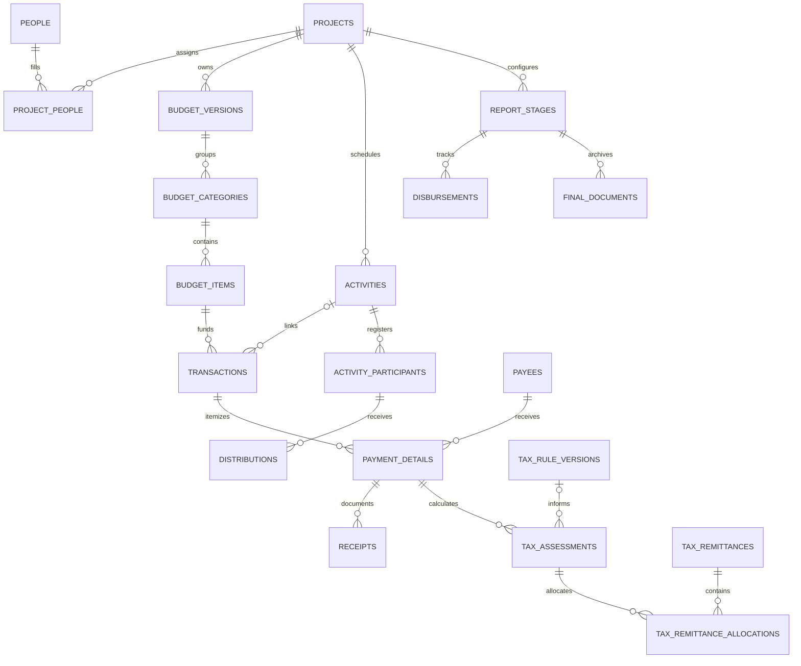

# Arsitektur dan ERD LPJ Litapdimas

Status: kontrak desain awal untuk [PRD.md](PRD.md).

## Runtime dan struktur folder

Antarmuka React + Vite dihosting di GitHub Pages (`github.io`). Google Sheets privat menyimpan tabel dan Google Drive privat menyimpan berkas bukti serta PDF. GitHub menyimpan sumber dan fixture sintetis. Google Apps Script menjadi kandidat layanan Tahap 0 tanpa mengaktifkan billing. Karena GitHub Pages menyajikan situs statis, adapter RPC di browser perlu memanggil layanan server yang memverifikasi identitas Google, mengecek peran dan cakupan proyek pada setiap permintaan, lalu mengakses Sheets dan Drive dengan izin layanan. Tahap 0 masih perlu menguji transport dan konfigurasi autentikasi Apps Script dari origin GitHub Pages. [Dokumentasi GitHub Pages](https://docs.github.com/en/pages/getting-started-with-github-pages/what-is-github-pages).

```text
src/
  app/               # navigasi dan shell
  features/          # projects, people, budgets, activities, transactions, taxes, reports
  components/ui/     # komponen bersama dan CSS Modules
  styles/            # tokens.css, globals.css, print.css
  lib/api/           # adapter RPC dan penanganan kegagalan
server/
  controllers/       # autentikasi, otorisasi, validasi envelope
  services/          # aturan domain dan alur dokumen
  repositories/      # akses tabel Sheets dan berkas Drive
  templates/         # template dokumen berversi
shared/contracts/    # DTO, action dan enum
tests/fixtures/      # data sintetis
```

UI menampilkan respons layanan. Perhitungan, perpindahan status, akses proyek, pemilihan aturan pajak dan snapshot berlaku di server. Repositori memakai header tabel dan ID stabil untuk lookup.

[Prototipe Tahap 0](stage0/README.md) memakai Google Sign-In di GitHub Pages dan POST Apps Script Content Service. Apps Script memvalidasi ID token melalui `tokeninfo` untuk uji sintetis, lalu menerapkan pemeriksaan keanggotaan yang sama dengan prototipe HTML Service. Sembilan pengujian lokal lulus dengan layanan Google disimulasikan. Pengguna melaporkan login dan akses dasar ketiga akun sesuai peran dari `github.io`. Uji penolakan di luar cakupan, perubahan hak pada sesi aktif, dan izin langsung Sheets/Drive masih tertunda. Verifikasi token produksi menunggu keputusan setelah uji. [Verifikasi token Google](https://developers.google.com/identity/gsi/web/guides/verify-google-id-token).

## Konvensi

Nama sheet, kolom, dan DTO memakai `snake_case`. ID entitas adalah UUID teks. Mata uang adalah integer rupiah. Persentase tersimpan dalam basis point (`7000 = 70%`). Tanggal kegiatan/pembayaran berupa `YYYY-MM-DD` dalam zona Asia/Jakarta. Stempel audit berupa ISO 8601 UTC. Setiap tabel mutabel memiliki `row_version`, `created_at`, dan `updated_at`. Kolom FK mengikuti nama PK tabel tujuan, kecuali qualifier seperti `approved_by_user_id`. Impor memperlakukan NIP/NIM sebagai teks. Validasi daftar nilai, tipe, FK dan kepemilikan proyek dilakukan pada setiap operasi.

## Skema Sheets

Setiap baris di bawah adalah satu tab logis. Kolom pertama adalah PK kecuali dinyatakan lain.

| Sheet | Kolom domain utama |
| --- | --- |
| users | user_id, login_email, system_role, active |
| project_members | project_member_id, project_id, user_id, project_role, revoked_at opsional. Unik project_id + user_id |
| people | person_id, person_kind, display_name, nip, nim, unit_name, civil_service_grade, active |
| payees | payee_id, payee_kind, person_id opsional, legal_name, tax_profile_ref. Vendor badan dan kelompok peserta dapat memakai entri sendiri |
| projects | project_id, fiscal_year, title, project_code, official_ceiling_amount, status, active_budget_version_id |
| project_people | project_person_id, project_id, person_id, assignment_role. Peran tunggal ketua, penanggung jawab, PPK, bendahara. Anggota, mahasiswa dan pejabat tambahan multi-entri |
| budget_versions | budget_version_id, project_id, version_no, status, approved_by_user_id, approved_at |
| budget_categories | budget_category_id, budget_version_id, category_code, label, sort_order |
| budget_items | budget_item_id, budget_category_id, label, volume, frequency, unit, unit_price_amount |
| report_stages | report_stage_id, project_id, sequence_no, label, target_bps, cutoff_date, status |
| disbursements | disbursement_id, report_stage_id, received_date, received_amount, attachment_id opsional |
| activities | activity_id, project_id, activity_kind, title, activity_date, location, status |
| agenda_items | agenda_item_id, activity_id, start_time, end_time, title, speaker_person_id opsional |
| logbook_entries | logbook_entry_id, project_id, activity_id opsional, entry_date, description, result |
| activity_participants | activity_participant_id, activity_id, person_id, attendance_status. Unik activity_id + person_id |
| distributions | distribution_id, activity_participant_id, transaction_id opsional, distribution_kind, quantity, received_at. Unik activity_participant_id + distribution_kind |
| transactions | transaction_id, project_id, budget_item_id, activity_id opsional, payment_date, expense_kind, description, status |
| payment_details | payment_detail_id, transaction_id, payee_id, receipt_amount, withheld_tax_amount, added_tax_amount, net_paid_amount |
| receipts | receipt_id, payment_detail_id, project_id, receipt_no, issued_on, status. Unik project_id + receipt_no dan satu bukti aktif per payment_detail_id |
| tax_rule_versions | tax_rule_version_id, rule_code, version_no, tax_kind, expense_kind, payee_kind, eligibility, base_kind, rate_bps, effective_from, effective_to, source_ref |
| tax_assessments | tax_assessment_id, payment_detail_id, tax_rule_version_id opsional, tax_kind, tax_treatment, tax_base_amount, amount, status, verified_by_user_id, verified_at, override_reason, decision_source_ref, evidence_attachment_id, evidence_row_version, evidence_drive_file_id, evidence_modified_at, rule_snapshot |
| tax_remittances | tax_remittance_id, project_id, paid_at, amount, attachment_id opsional |
| tax_remittance_allocations | tax_remittance_allocation_id, tax_remittance_id, tax_assessment_id, amount |
| attachments | attachment_id, project_id, activity_id opsional, transaction_id opsional, attachment_kind, drive_file_id |
| final_documents | final_document_id, project_id, report_stage_id, document_kind, version_no, template_version, pdf_drive_file_id, snapshot_drive_file_id, finalized_by_user_id, finalized_at |
| audit_log | audit_id, request_id, user_id, project_id opsional, action, entity_type, entity_id, occurred_at, change_summary |
| mutation_requests | request_id, user_id, action, payload_digest, result_ref, status |
| settings | setting_key, setting_value. Simpan versi skema dan konfigurasi non-rahasia |



## Kontrak RPC v1

Satu adapter UI mengirim objek ke controller `dispatch`. Controller menerima action yang terdaftar, menurunkan identitas dari sesi tepercaya, lalu mengecek peran dan cakupan proyek. Semua mutasi memakai `request_id`. Mutasi atas baris yang sudah ada menyertakan `expected_row_version` atau versi pada tiap baris untuk batch. Parameter tanggal dan waktu dikirim sebagai string.

```json
{"api_version":1,"action":"transactions.confirm","request_id":"<uuid>","project_id":"<uuid>","payload":{"transaction_id":"<uuid>","expected_row_version":4}}
```

```json
{"ok":true,"request_id":"<uuid>","data":{"transaction_id":"<uuid>","row_version":5,"status":"CONFIRMED"}}
```

```json
{"ok":false,"request_id":"<uuid>","error":{"code":"TAX_REVIEW_REQUIRED","message":"Pajak transaksi perlu diverifikasi.","field_errors":{}}}
```

| Action | Masukan utama | Keluaran dan akses |
| --- | --- | --- |
| projects.list / projects.get | cursor, limit / project_id | Proyek dalam cakupan pengguna |
| projects.save / projects.activate | data wizard / project_id dan versi | Pemilik. Aktivasi memeriksa kelengkapan peran |
| people.search / people.preview_import / people.commit_import | query / baris dari CSV atau XLSX / import_token | Pencarian sesuai akses. Impor oleh pemilik menghasilkan ringkasan dan konflik |
| budgets.list_versions / budgets.save_version / budgets.approve_version | budget_version_id opsional / kategori dan item / budget_version_id dan versi baris | Pembaca berwenang melihat riwayat. Pemilik dan editor menyusun draf. Pemilik mengesahkan versi |
| activities.save / participants.preview_import / participants.commit_import / distributions.save / logbook.save | data kegiatan, agenda, peserta, distribusi, logbook | Pemilik atau anggota dengan hak edit pada proyek |
| logbook.list | project_id | Entri dan pilihan kegiatan dalam proyek pengguna, beserta can_write berdasarkan peran dan status proyek |
| participants.list / participants.save | activity_id / activity_id, activity_participant_id, attendance_status, expected_row_version | Pembaca proyek melihat daftar; pemilik/editor mengubah status hadir dengan versi |
| reports.preview (paket kegiatan) | payload.activity_id, document_kind = ACTIVITY_PACKAGE | Pembaca proyek memperoleh satu pembacaan konsisten untuk draf rundown, logbook terkait, daftar hadir, serta snack/konsumsi/transport |
| disbursements.save | report_stage_id, received_date, received_amount, attachment_id | Pemilik |
| transactions.list / transactions.save | filter / rincian transaksi, pembayaran, penerima, bukti | Pembaca berwenang / anggota dengan hak edit pada proyek |
| taxes.save_rule_version / taxes.preview / taxes.verify | aturan / payment_detail_id / assessment, hasil dan alasan koreksi jika ada | Kelola dan verifikasi oleh pemilik. Preview tersedia bagi anggota dengan hak edit |
| taxes.list_rules | tanpa project_id; semua versi aturan global | Pemilik saja, saat TAXES_ENABLED=true |
| tax_remittances.save | paid_at, amount, allocation dan bukti | Pemilik. Alokasi tidak melebihi potongan terkait |
| transactions.confirm / receipts.issue | transaction_id / payment_detail_id | Pemilik. Konfirmasi dan penerbitan mengembalikan versi atau nomor bukti |
| stages.save / reports.preview / reports.finalize | konfigurasi / report_stage_id, document_kind / pilihan paket dan versi sumber | Pemilik menetapkan tahap dan finalisasi. Pratinjau tersedia bagi anggota yang punya akses |
| attachments.link / attachments.get | konteks dan file Drive yang sudah diotorisasi / attachment_id | Hak akses mengikuti proyek dan berkas |
| attachments.list | transaction_id dalam proyek envelope | Pemilik/editor; metadata bukti, tautan folder khusus pemilik; tanpa mengubah izin Drive |
| audit.list | project_id, cursor, limit | Pemilik |

Untuk tahap awal, `projects.list` juga mengembalikan `system_role` dari akun yang sudah diverifikasi untuk menentukan menu di UI. Pencarian Master Personel tanpa konteks proyek hanya untuk pemilik. `people.search` menerima `payload.query` (maksimal 120 karakter) dan mengembalikan maksimal 50 entri aktif yang cocok berdasarkan nama atau unit, serta `total` kecocokan. Hasil memuat `person_id`, `person_kind`, `display_name`, dan `unit_name`. Fixture lama tanpa kolom `active` tetap dapat dibaca selama pengembangan.

Wizard pembuatan mengirim `projects.save` tanpa `project_id`. Payload berisi `project` (judul, kode opsional, tahun anggaran, plafon), `personnel` (ID personel dan peran), dan `stages` (urutan, label, basis point, tanggal batas). Proyek lengkap disimpan sebagai `DRAFT`. `projects.activate` menerima `project_id` dan `payload.expected_row_version`, lalu memvalidasi ulang isi draf dan referensi personel sebelum memindahkan status menjadi `ACTIVE`. Kedua aksi mengembalikan `project_id`, `status`, dan `row_version`. `projects.list` menyertakan `can_create_project` saat akun pemilik dan deployment mengaktifkan penulisan. Penyuntingan draf yang sudah tersimpan belum tersedia pada irisan ini.

Impor Master Personel memetakan CSV atau lembar pertama XLSX di browser. `people.preview_import` menerima `payload.rows`, yaitu baris berisi `source_row` dan field master yang dipetakan. Server mengembalikan `import_token`, klasifikasi per baris, dan jumlah untuk tiap status. `people.commit_import` menerima baris yang sama serta token. Token berumur hingga 10 menit dan terikat pada pemilik, spreadsheet, isi batch, dan hasil pratinjau. Commit memeriksa ulang konflik di bawah lock, menambahkan baris valid, dan menyimpan audit serta jurnal permintaan dalam satu batch. Duplikasi diperiksa berdasarkan `person_id`, NIP, atau NIM. Menu impor muncul ketika `projects.list` mengembalikan `can_import_people`.

RAB memakai `project_id` pada setiap RPC. `budgets.list_versions` dapat memilih `payload.budget_version_id` dan mengembalikan versi proyek, riwayat, rincian versi terpilih, plafon, total, dan selisih. `budgets.save_version` membuat draf baru dari `payload.categories` beserta item. Versi yang sudah tersimpan memiliki item dengan ID stabil. `budgets.approve_version` memeriksa `payload.expected_row_version` dan `payload.expected_project_row_version`. Pengesahan mengubah proyek dan kedua status versi dalam satu batch. Versi lama berstatus `SUPERSEDED` dan tetap dapat dibuka. Volume dapat memiliki hingga tiga desimal, frekuensi bilangan bulat positif, dan harga satuan rupiah integer. Server menghitung dalam seperseribu rupiah sebelum membulatkan tiap baris ke rupiah terdekat, dengan setengah rupiah dibulatkan ke atas. Nominal berskala per baris dan total rupiah harus berada dalam batas integer aman JavaScript. Selisih adalah plafon dikurangi jumlah seluruh baris.

Gunakan `UNAUTHENTICATED`, `FORBIDDEN`, `NOT_FOUND`, `VALIDATION_ERROR`, `CONFLICT`, `TAX_REVIEW_REQUIRED`, dan `TEMPORARY_FAILURE` untuk kegagalan yang dapat ditangani klien. Pratinjau impor menghasilkan token berumur terbatas, terikat pengguna dan isi batch. Commit memeriksa ulang duplikasi dan hak akses.

Irisan awal LPJ-04 menyediakan `activities.list`, `activities.get`, dan `activities.save` pada proyek yang diotorisasi. List mengembalikan `activities`; get menerima `payload.activity_id` dan mengembalikan `activity` beserta `agenda`. Pembuatan draf baru mengirim `payload.activity` (`activity_kind`, `title`, `activity_date`, `location`) dan `payload.agenda` (daftar `start_time`, `end_time`, `title`, `speaker_person_id` opsional). Jam memakai `HH:mm`, sesi dalam satu hari harus berurutan tanpa tumpang tindih. Pembicara merujuk Master Personel aktif. Server menghasilkan ID dan status, lalu menyimpan kegiatan, sesi, audit, serta jurnal idempotensi dalam satu batch di bawah script lock. Pemilik/editor dapat membuat pada proyek `DRAFT` atau `ACTIVE`; viewer hanya membaca. Retry yang sudah selesai dapat dibaca kembali setelah proyek diarsipkan selama akses pengguna masih berlaku. Aktifkan `ACTIVITIES_ENABLED` hanya di deployment sintetis yang skemanya siap. Penyuntingan dan pratinjau cetak draf tersedia sebagaimana kontrak di bawah; penerimaan deployment Google dan pengesahan format dokumen masih tertunda.

`logbook.save` menerima `payload.entry_date`, `description`, `result`, dan `activity_id` opsional (kosong berarti tanpa kegiatan). Uraian serta hasil wajib terisi dan masing-masing dibatasi 4.000 karakter. Untuk menyunting, kirim `logbook_entry_id` dan `expected_row_version`; server menolak versi lama dengan `CONFLICT`. ID entri serta kegiatan harus berasal dari proyek pada envelope. Respons save memuat `logbook_entry_id` dan `row_version`. `logbook.list` mengembalikan `entries` (dengan `activity_title` untuk tampilan), `activities` (ID/judul/tanggal kegiatan proyek), dan `can_write`. Entri diurutkan dari tanggal terbaru. List tersedia bagi pembaca proyek; penulisan hanya untuk pemilik/editor pada proyek draf atau aktif. Semua penulisan memakai lock, pemeriksaan jurnal idempotensi, serta batch atomik entri/audit/jurnal. Koreksi mempertahankan `created_at` dan menyimpan sebelum/sesudah dalam audit. `LOGBOOK_ENABLED` mengaktifkan fitur pada deployment sintetis dan menentukan `logbook_enabled` di respons `projects.get`. UI logbook menyediakan tambah/sunting, kegiatan opsional, pencarian, delapan entri per halaman, serta retry dengan isian dan UUID yang sama jika hasil simpan belum diketahui.

`participants.list` menerima `payload.activity_id`, lalu mengembalikan `participants` beserta nama dan `distributions` masing-masing, pilihan `project_people` aktif (ID/nama), serta `can_write`. Daftar hanya memuat peserta kegiatan dalam proyek envelope. Aktifkan `PARTICIPANTS_ENABLED` pada deployment sintetis yang sudah menyiapkan skema; `activities.get` menyertakan `participants_enabled` untuk UI di detail kegiatan.

`participants.preview_import` menerima `payload.activity_id` dan `rows` berisi `source_row`, `person_id`, serta `attendance_status` (kosong menjadi `UNRECORDED`). Batasnya 1.000 baris. ID harus merujuk satu Master Personel aktif; baris dengan orang berulang dalam batch memerlukan koreksi. Orang yang sudah terdaftar pada kegiatan menjadi duplikat dan tidak mengubah status hadir atau distribusinya. Respons memuat hasil per baris, ringkasan valid/duplikat/koreksi, dan `import_token` selama maksimal 10 menit. Token terikat pengguna, spreadsheet, proyek, kegiatan, isi baris, serta hasil pemeriksaan. `participants.commit_import` mengirim baris dan token yang sama, memeriksa ulang di bawah lock, lalu menambahkan hanya baris valid. Commit ulang dengan UUID yang sama mengembalikan hasil semula meski cache token sudah dihapus. CSV memakai header `person_id` dan `attendance_status` opsional; impor peserta tidak membuat Master Personel baru.

`participants.save` memperbarui `attendance_status` (`UNRECORDED / PRESENT / ABSENT`) memakai `activity_participant_id` dan `expected_row_version` dalam konteks `activity_id`. `distributions.save` menerima konteks kegiatan dan peserta yang sama, `distribution_kind` (`SNACK / CONSUMPTION / TRANSPORT`), `quantity` integer 0–1.000.000, `received_at`, serta `expected_row_version`. Versi 0 berarti belum ada catatan untuk pasangan peserta/jenis itu. Jumlah positif memerlukan timestamp UTC kanonik `YYYY-MM-DDTHH:mm:ss.sssZ`; jumlah 0 memakai string kosong dan berarti belum diterima/koreksi penerimaan. UI memasukkan waktu WIB lalu mengonversinya ke UTC. Kehadiran dan distribusi memakai baris/versi terpisah. Jumlah unit bukan rupiah dan belum masuk rekap transaksi. Penautan `transaction_id` baru belum tersedia pada irisan ini, dan distribusi yang sudah tertaut transaksi ditolak jika diubah lewat RPC ini.

Mutasi peserta/distribusi hanya untuk pemilik/editor pada proyek draf atau aktif, dengan audit serta jurnal idempotensi dalam satu batch atomik di bawah lock. Kegiatan dan peserta dari proyek/kegiatan lain ditolak. Pembaca dapat melihat arsip; pencabutan hak tetap diperiksa pada tiap RPC. UI menyediakan pratinjau CSV atau penambahan dari personel proyek, pencarian, delapan peserta per halaman, serta formulir terpisah untuk hadir dan penerimaan. Retry dengan hasil belum diketahui mempertahankan payload/UUID dan mengunci isian.

Penyuntingan kegiatan memakai `activities.save` dengan `payload.activity_id`, `expected_row_version`, dan `expected_agenda_versions` berupa objek `{agenda_item_id: row_version}` untuk seluruh sesi yang dibaca. `payload.activity` dan `agenda` membawa isi lengkap versi baru. Sesi lama menyertakan `agenda_item_id`; sesi baru tidak menyertakannya. Server memeriksa kepemilikan ID, versi induk/semua sesi, serta status kegiatan `DRAFT` pada proyek draf/aktif. Sesi yang dikeluarkan dari daftar dihapus fisik di bawah lock, dalam batch atomik yang sama dengan pembaruan/penambahan sesi, induk, audit dan jurnal. Helper batch memperbarui baris terlebih dahulu, menghapus dari indeks terbesar ke terkecil, lalu menambahkan baris. ID kegiatan dan sesi yang dipertahankan tetap sama, sehingga hubungan logbook/peserta tidak berubah. `created_at` tetap dipertahankan. Audit memuat sebelum/sesudah data kegiatan, ID sesi yang dihapus, dan digest rundown sebelum/sesudah. `activities.get.can_write` menentukan ketersediaan tombol sunting di UI.

Pratinjau draf memakai `reports.preview` dengan `document_kind=ACTIVITY_PACKAGE` dan `activity_id`, diaktifkan oleh `ACTIVITY_REPORTS_ENABLED`. `activities.get.reports_enabled` mengendalikan tombol pratinjau. Server mengambil proyek, kegiatan, agenda, logbook yang tertaut, peserta, dan distribusi dalam satu script lock; semua data dipotong menurut proyek serta kegiatan. Respons memuat `is_final=false`, `template_version=activity-draft-v1`, `generated_at`, dan keenam kelompok data. Daftar distribusi hanya berisi jumlah positif, dengan total unit dihitung server. Hadir dan penerimaan tetap terpisah; peserta tidak hadir dapat muncul pada daftar penerimaan. UI menampilkan enam bagian A4 dalam dialog native, mengembalikan fokus saat ditutup, dan mencetak hanya isi draf melalui CSS print. PDF disimpan melalui dialog cetak browser. Tahap ini belum membuat snapshot/arsip Drive atau metadata `final_documents`; finalisasi tetap memerlukan alur LPJ-08/09.

Irisan awal transaksi (LPJ-05, fondasi LPJ-06/07/09) mengaktifkan `transactions.list` dan `transactions.save` melalui `TRANSACTIONS_ENABLED`; `projects.get` menyertakan `transactions_enabled` untuk UI. Save menerima `payload.transaction` (`budget_item_id`, `activity_id` opsional/kosong, `payment_date`, `expense_kind`, `description`) dan `payments` sebanyak 1–30 penerima berbeda. Jenis belanja adalah `HONOR / TRANSPORT / CONSUMPTION / SNACK / OTHER`; uang saku yang merupakan transport memakai `TRANSPORT` dan tidak membuat pos kedua. Penerima merujuk tab `payees` dengan jenis `PERSON / ORGANIZATION / GROUP`.

Tiap pembayaran mengirim `payee_id`, `receipt_amount` positif dan `withheld_tax_amount` nonnegatif dalam rupiah integer aman. Usulan potongan tidak boleh melebihi nilai kwitansi. Server menghitung `net_paid_amount = receipt_amount - withheld_tax_amount`, mengabaikan netto kiriman klien, dan memeriksa batas integer setiap total. Irisan ini hanya menerima `added_tax_amount` kosong/0; pajak tambahan memerlukan alur rekonsiliasi tagihan berikutnya. Status kiriman klien tidak digunakan: semua save menghasilkan `DRAFT`. Potongan masih berupa usulan, belum menjadi penetapan pajak atau persetujuan pemilik. Usulan berdasarkan aturan dan verifikasi potongan tersedia lewat alur pajak di bawah. Unggah langsung dari aplikasi, konfirmasi transaksi, kwitansi bernomor, dan rekap tahap masih menyusul.

Transaksi baru harus merujuk item pada RAB `APPROVED` aktif di proyek envelope. Saat revisi RAB menjadi aktif, draf lama boleh mempertahankan item lamanya pada versi `APPROVED/SUPERSEDED`; transaksi baru atau penggantian item harus memakai versi aktif. ID item tidak dipindah otomatis. Kegiatan harus berasal dari proyek yang sama. Pemilik dapat memilih penerima master yang valid. Anggota hanya dapat memilih payee personel proyek/peserta kegiatan proyek atau payee yang sudah digunakan pada transaksi proyek itu. Respons pilihan hanya memuat ID, jenis dan nama penerima; `tax_profile_ref` tidak dikirim ke browser. Pengelolaan master payee masih melalui konfigurasi spreadsheet sintetis, belum formulir aplikasi.

Penyuntingan mengirim `transaction_id`, `expected_row_version`, serta `expected_payment_versions` berupa objek ID pembayaran → versi untuk seluruh pembayaran lama. Pembayaran yang dipertahankan menyertakan `payment_detail_id`; yang baru tidak menyertakannya. Pembayaran yang dikeluarkan dihapus di bawah lock bersama perubahan induk, audit nilai sebelum/sesudah, dan jurnal idempotensi dalam satu batch atomik. Hanya pemilik/editor pada proyek draf/aktif yang dapat menulis. Transaksi selain `DRAFT`, pembayaran yang sudah tertaut penilaian pajak/kwitansi, atau transaksi yang tertaut distribusi tidak dapat disunting lewat alur ini. Retry yang sudah selesai mengembalikan hasil semula, tetap setelah pemeriksaan hak pengguna saat ini.

`transactions.list` mengembalikan transaksi beserta `payments`, `totals`, label item dan versi RAB, kegiatan, serta `can_edit`. Respons juga berisi pilihan `budget_items` (aktif atau dirujuk transaksi proyek), `activities`, `payees`, `can_write`, `can_create`, `draft_total_amount`, dan `confirmed_total_amount`. Total terkonfirmasi hanya menjumlahkan nilai kwitansi transaksi berstatus `CONFIRMED`, bukan netto; total draf ditampilkan terpisah. Pembayaran tersimpan yang netto/nilai rupiahnya tidak konsisten menyebabkan kegagalan pembacaan, bukan koreksi diam-diam. UI menyediakan tambah/sunting draf, penerima dinamis, pencarian, delapan transaksi per halaman, dan retry dengan payload/UUID yang sama saat hasil simpan belum diketahui.

### Bukti transaksi di Drive

`ATTACHMENTS_ENABLED=true` mengaktifkan `attachments.list`, `attachments.get`, dan `attachments.link` untuk pemilik/editor dalam proyek yang diizinkan. Viewer ditolak. `transactions.list.can_manage_attachments` menentukan penampilan panel bukti. Berkas diunggah melalui Drive; aplikasi menautkan berkas yang sudah ada tanpa menyalin isi atau mengubah izin Drive. Metadata tidak disimpan di repo publik. Tautan folder hanya dikirim kepada pemilik; editor menautkan ID yang disiapkan pemilik dan tidak otomatis mendapat akses langsung folder.

Script Property privat `EVIDENCE_FOLDERS_JSON` memetakan UUID proyek ke satu ID folder bukti yang berbeda untuk setiap proyek. Folder dan berkas harus tersedia, tidak di sampah, dan memiliki kelas akses `PRIVATE`. Berkas harus berada **langsung** di folder proyek tersebut, berupa PDF/JPEG/PNG maksimal 20 MiB; shortcut dan subfolder ditolak. Pengecekan menggunakan [File.getParents/getMimeType/getSize](https://developers.google.com/apps-script/reference/drive/file) dan [Folder](https://developers.google.com/apps-script/reference/drive/folder). Kelas `PRIVATE` tidak mengaudit seluruh izin individu atau izin turunan; matriks akses langsung Drive tetap harus diuji. Tautan folder/berkas tidak memberi hak baru kepada akun aplikasi.

`attachments.list` menerima `payload.transaction_id`, mengembalikan `{attachments, can_link, transaction_row_version, folder_url}`. `attachments.get` menerima `attachment_id` dan mengembalikan `{attachment}` hanya setelah memeriksa proyek serta transaksi asal. Metadata berkas tersedia bagi pemilik/editor proyek melalui alur ini; preview pajak tetap membatasi metadata Drive ke pemilik. Bukti yang tidak tersedia atau tidak memenuhi batas folder/jenis hanya mengembalikan ID attachment, jenis, versi, dan `available=false`, tanpa nama/ID berkas Drive.

`attachments.link` menerima `transaction_id`, `attachment_id` (kosong untuk baru), `expected_transaction_row_version`, `expected_attachment_row_version` (0 untuk baru), `attachment_kind=PAYMENT_PROOF`, dan `drive_file_id`. UI boleh menerima tautan Drive, tetapi hanya mengirim ID yang sudah dinormalisasi; server hanya menerima ID. ID attachment baru dibuat server, activity_id diturunkan dari transaksi, dan maksimal 50 bukti per transaksi. Berkas yang sama tidak dapat diduplikasi pada transaksi sama atau ditautkan lintas proyek. Penggantian hanya melalui attachment pembayaran yang sudah berada dalam transaksi/proyek tersebut. Versi transaksi dan attachment diperiksa di bawah lock; attachment, versi transaksi, audit sebelum/sesudah/metadata berkas, serta jurnal idempotensi ditulis atomik. Retry UUID/payload sama mengembalikan hasil semula.

Penautan/penggantian hanya untuk transaksi draf pada proyek draf/aktif, tanpa kwitansi, alokasi setoran, atau distribusi tertaut. Penilaian pajak yang sudah tersimpan tidak ditimpa; perubahan attachment membuat versi buktinya berbeda dan penilaian memerlukan tinjauan ulang. Token preview pajak lama tidak lagi valid. Ketika fitur aktif **atau** pemetaan folder sudah dikonfigurasi, preview/verifikasi pajak memeriksa ulang batas folder, jenis, ukuran, akses dan waktu perubahan berkas. Menonaktifkan penautan tidak menonaktifkan pemeriksaan folder yang sudah dikonfigurasi. Metadata bukan snapshot atau arsip file final. Unggah langsung dari aplikasi, penghapusan tautan, dan penautan konteks nontransaksi menyusul.

### Penilaian pajak

Irisan penilaian pajak LPJ-06/09 mengaktifkan `taxes.preview`, `taxes.verify`, `taxes.list_rules`, dan `taxes.save_rule_version` melalui `TAXES_ENABLED`. `transactions.list.can_preview_taxes` menampilkan penilaian bagi pemilik/editor; viewer tidak mendapat aksi pajak. Probe hak pada panel Tahap 0 dipindahkan ke `stage0.tax_probe`, sehingga `taxes.verify` tidak lagi memberi respons sukses yang hanya berarti pemeriksaan hak.

Pengelolaan aturan bersifat global, tanpa `project_id`. `projects.list.can_manage_tax_rules` hanya bernilai true untuk pemilik ketika fitur pajak aktif. `taxes.list_rules` mengembalikan `{rules}` dengan `eligibility` sebagai objek, diurutkan berdasarkan kode dan versi menurun. `taxes.save_rule_version` menerima `rule_code` (huruf kapital/angka/garis bawah, diawali huruf, maksimal 80), `expected_latest_version` (0 untuk kode baru), `tax_kind`, `expense_kind`, `payee_kind`, `eligibility`, `base_kind=RECEIPT_AMOUNT`, `rate_bps`, `effective_from`, `effective_to` (kosong untuk tanpa batas), dan `source_ref`. ID dan nomor versi ditetapkan server. Jenis pajak/belanja/penerima/dasar harus tetap untuk kode yang sama. Tarif harus integer 0–10.000 basis point; tanggal inklusif dan syarat golongan divalidasi. Respons berisi `tax_rule_version_id`, `rule_code`, dan `version_no`.

Versi selalu ditambahkan, tidak ditimpa atau dihapus. Simpan memeriksa versi terbaru di bawah script lock dan menulis versi, audit global (`project_id` kosong), serta jurnal idempotensi dalam satu batch. Retry memakai UUID/payload sama; versi yang berubah menghasilkan `CONFLICT`. Tidak ada tarif produksi bawaan. UI mempertahankan draf ketika konflik, memuat daftar terbaru, dan meminta pemilik meninjau acuan versi sebelum mencoba lagi.

Untuk satu `rule_code`, pemilihan dilakukan dengan menyaring periode yang mencakup tanggal pembayaran, lalu memilih `version_no` tertinggi, baru memeriksa jenis penerima/belanja dan golongan. Tidak ada fallback ke syarat golongan versi lebih rendah dalam periode yang sudah digantikan. Di luar periode versi baru, versi lama yang masih mencakup tanggal tersebut dapat kembali menjadi acuan. Aturan dari kode berbeda yang sama-sama cocok tetap dianggap ambigu. Penambahan aturan tidak mengubah netto atau snapshot penilaian lama; preview menandai penilaian dengan ID aturan yang sudah bukan kandidat sebagai perlu ditinjau ulang. Perubahan aturan membatalkan token preview sebelumnya. Sebelum menerapkan pemilihan ini pada spreadsheet lama, pemilik perlu meninjau baris dengan kode sama dan periode yang beririsan.

Pratinjau menerima `payload.payment_detail_id` dan memastikan pembayarannya berada dalam proyek envelope. Aturan yang tersimpan pada `tax_rule_versions` dibaca menurut tanggal pembayaran inklusif, jenis belanja/penerima, dan `eligibility` JSON yang saat ini hanya mendukung `civil_service_grades` (daftar golongan yang cocok persis) atau `{}`. Basis yang didukung adalah `RECEIPT_AMOUNT`; `rate_bps` 0–10.000. Honor memerlukan payee `PERSON`, referensi profil pajak, dan personel dosen/pegawai dengan golongan terisi. Usulan hanya muncul jika tepat satu aturan cocok dan tidak ada kekurangan tersebut. Konsumsi/snack tetap memerlukan tinjauan klasifikasi/bukti. Ketiadaan aturan, aturan ganda, atau profil kurang tidak diputuskan otomatis. Status pratinjau tetap `PENDING`, sekalipun ada usulan. Perhitungan rupiah memakai pembagian integer dan pembulatan setengah ke atas, tanpa perkalian besar yang melampaui batas integer aman. Tidak ada tarif produksi bawaan. Pemilik mengelola versi dan referensi melalui UI/RPC di atas; versi lama tetap tersimpan.

Respons preview memuat `payment`, `transaction`, nama penerima, `proposal` (alasan dan nominal opsional), `candidates`, satu `assessment` terdahulu bila ada, `needs_review`, dan `can_verify`. Pemilik juga mendapat `preview_token` berumur maksimal 10 menit dan pilihan bukti yang tertaut ke transaksi/proyek yang sama. Bukti diperiksa lewat DriveApp untuk ketersediaan, status tidak dibuang, kelas akses `PRIVATE`, serta waktu perubahan. Kelas `PRIVATE` bukan audit seluruh izin individu/izin turunan; matriks akses langsung tetap wajib diuji. Nama/ID berkas dan waktu perubahan hanya dikirim ke pemilik. [API File](https://developers.google.com/apps-script/reference/drive/file), [kelas akses Drive](https://developers.google.com/apps-script/reference/drive/access).

`taxes.verify` hanya untuk pemilik. Payload berisi `payment_detail_id`, `preview_token`, `expected_transaction_row_version`, `expected_payment_row_version`, `expected_assessment_row_version` (0 untuk baru), `tax_rule_version_id` opsional/kosong, `tax_kind`, `tax_base_amount`, `amount`, `status` (`VERIFIED / NOT_APPLICABLE`), `evidence_attachment_id`, `decision_source_ref`, dan `override_reason`. Basis/nominal tidak melebihi nilai kwitansi, dan tidak dikenai pajak memerlukan nominal 0. Keputusan manual, usulan yang tidak tunggal, perbedaan dari usulan, koreksi lama, atau `NOT_APPLICABLE` mewajibkan alasan. Referensi keputusan dan bukti tetap wajib pada semua keputusan. Token terikat pengguna, proyek, pembayaran, profil, aturan, penilaian, dan metadata bukti. Perubahan konteks atau token kedaluwarsa menghasilkan `CONFLICT`.

Irisan ini mendukung satu penilaian potongan per pembayaran. Jika sudah ada beberapa penilaian, kwitansi, alokasi setoran, distribusi tertaut transaksi, status transaksi bukan draf, atau proyek diarsipkan, verifikasi ditolak melalui alur ini. Verifikasi memperbarui atau menambah penilaian, menyimpan salinan aturan `rule_snapshot`, identitas/waktu pemilik, referensi/alasan, versi attachment dan metadata berkas yang diperiksa, lalu menghitung ulang potongan/netto pembayaran. Versi pembayaran dan transaksi naik, tetapi status transaksi tetap `DRAFT`. Penilaian, pembayaran, transaksi, audit sebelum/sesudah, dan jurnal idempotensi ditulis atomik di bawah lock. Retry selesai memakai UUID/payload yang sama tetap mengembalikan hasil semula. Bukti yang berubah setelah keputusan ditandai untuk tinjauan ulang saat pratinjau pemilik; metadata ini belum menjadi salinan bukti atau snapshot arsip final.

Pengunggahan langsung dari aplikasi, verifikasi beberapa jenis pajak sekaligus, pajak tambahan, konfirmasi transaksi, penerbitan kwitansi, dan setoran tetap menyusul. Konfirmasi/finalisasi nantinya harus memeriksa ulang penilaian dan bukti terkini, bukan hanya menerima status `VERIFIED` yang tersimpan.

## Integritas dan operasi

Aktivasi deployment sintetis dapat memakai helper manual `setupSyntheticFeatures` pada `DeploymentSetup.gs`. Fungsi tidak didaftarkan sebagai RPC, memerlukan identitas aktif Google yang cocok dengan satu pemilik aktif di `users`, dan hanya menerima spreadsheet berjudul Data Uji. Di bawah script lock, helper memeriksa seluruh header kontrak dan pemetaan folder; pemetaan lama dipertahankan bila valid. Jika belum ada pemetaan, folder `Bukti <project_id>` harus unik dan privat di folder induk spreadsheet yang tunggal. Sesudah semua pemeriksaan berhasil, helper menulis flag serta pemetaan tanpa menghapus properti lain. Helper tidak mengisi transaksi/personel/tarif atau menormalisasi proyek lama. Aktivasi bukan bukti penerimaan integrasi; uji Google tetap harus dijalankan.

UI kegiatan berada di `src/features/activities/ActivityWorkspace.jsx`, ditampilkan dari detail proyek saat `projects.get` mengembalikan `activities_enabled=true`. Respons personel proyek menyertakan `person_id` untuk pilihan pembicara. `activities.list` menyertakan `can_write` berdasarkan peran dan status proyek yang diperiksa server. `activities.get` menyertakan `speaker_display_name` pada sesi untuk tampilan, tanpa mengubah referensi `speaker_person_id`. UI membatasi tampilan daftar menjadi delapan kegiatan per halaman. Jika koneksi gagal setelah kirim simpan, UI mengunci isian dan memakai payload serta UUID yang sama saat retry; kesalahan domain yang definitif membolehkan koreksi isian. Form yang sama menyediakan penyuntingan kegiatan draf dengan pemeriksaan versi induk dan semua sesi. Pengujian browser memakai RPC dan login sintetis, bukan bukti integrasi Google sungguhan.

- Peran sistem `OWNER` dan `MEMBER`. Pemilik mengelola semua proyek. Anggota yang diundang memiliki `EDITOR` atau `VIEWER` pada `project_members` untuk tiap proyek yang ditugaskan. Tambahkan `revoked_at` untuk pencabutan. Server mengecek akun aktif, proyek, dan hak pada setiap RPC serta akses lampiran. PPK, Bendahara Pengeluaran, dan mahasiswa tercatat di `project_people` untuk dokumen LPJ tanpa akun atau hak aplikasi. Akun tanpa identitas tepercaya ditolak.
- Status inti: proyek `DRAFT / ACTIVE / ARCHIVED`, RAB `DRAFT / APPROVED / SUPERSEDED`, transaksi `DRAFT / CONFIRMED / VOID`, pajak `PENDING / VERIFIED / NOT_APPLICABLE`, kwitansi `ISSUED / VOID`, tahap `DRAFT / FINALIZED`. `NOT_APPLICABLE` dicatat oleh pemilik. Koreksi dokumen final diterbitkan sebagai versi baru dengan jejak audit.
- Hitung target dari plafon dan `target_bps`. Realisasi kumulatif menjumlahkan `receipt_amount` untuk rincian transaksi `CONFIRMED` sampai tanggal batas yang inklusif. `receipt_amount` adalah nilai yang disahkan sebagai dasar LPJ dari kwitansi. `net_paid_amount` adalah pembayaran ke penerima. Untuk honor, netto sama dengan nilai bruto dikurangi potongan. Untuk vendor, rekonsiliasi bagian pajak tambahan terhadap bukti tagihan agar bagian yang sudah termasuk dalam nominal kwitansi tidak ditambahkan kembali. Nilai dan status final tunduk pada verifikasi pemilik berdasarkan bukti. Setoran memiliki rekap tersendiri.
- Pemilihan versi aturan pajak memakai tanggal transaksi dan profil penerima yang relevan. Ketiadaan aturan, data yang kurang, atau dua aturan yang sama-sama cocok menghasilkan `PENDING`. Data historis 4% konsumsi dan snack tidak menjadi tarif default.
- Layanan penulisan memakai script lock untuk pemeriksaan versi dan alokasi nomor bukti, serta jurnal permintaan untuk idempotensi. Tulis perubahan Sheet terkait, audit, dan hasil permintaan dalam satu batch atomik pada spreadsheet yang sama. Pemakaian ulang request ID dengan payload berbeda menghasilkan konflik. Penerbitan PDF ke Drive memakai ID operasi dan publikasi metadata final sesudah file dan snapshot tersedia. Operasi parsial dapat dilanjutkan dengan ID yang sama.
- Isolasi spreadsheet, folder Drive dan konfigurasi produksi. Gunakan akses minimum, cadangan sheet dan file secara berkala, serta uji pemulihan dengan akun pemilik. Pastikan izin langsung ke file privat tidak dapat dipakai untuk melewati otorisasi layanan. Uji penolakan identitas kosong, akun tanpa undangan, dan akses lintas proyek sebelum deployment produksi.
